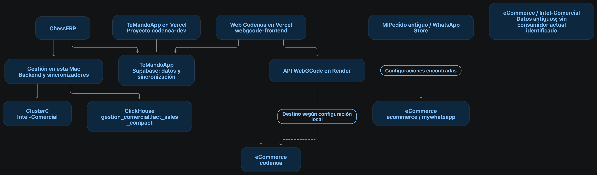

# Diagrama histórico de dependencias MongoDB

El diagrama conserva la fotografía de la auditoría inicial, cuando Gestión se
ejecutaba en la Mac. Desde entonces Gestión también se desplegó en Render; por
eso el nodo «Gestión en esta Mac» no describe por sí solo el alojamiento actual.

Las líneas punteadas distinguen destinos encontrados en configuraciones de
conexiones cuyo uso productivo no quedó confirmado en esa fotografía. La etiqueta
«sin consumidor actual identificado» expresa el límite de aquella revisión, no
una autorización para eliminar la base. La auditoría y consolidación de los
clústeres quedó pospuesta.

Se versiona la imagen como antecedente documental. Este archivo no cambia
conexiones, variables de entorno, servicios ni bases de datos.
