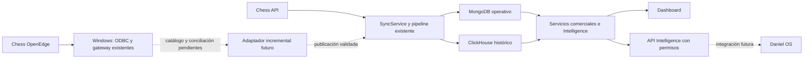

# Integración Chess ODBC: auditoría y primera etapa

Fecha: 15/10/2026. Repositorio: `danfranco73/Intel-Comercial`, carpeta local
`GESTION`. Base auditada: `c223959`. Rama: `feature/odbc-readonly-foundation`.

## Resultado y alcance

IntelComercial ya tiene un pipeline API → MongoDB/ClickHouse y servicios de
Intelligence. La integración debe incorporar una fuente verificada a ese circuito.
La primera etapa incorpora una herramienta independiente de inspección de catálogo;
no conecta ODBC a los escritores de ventas ni modifica la aplicación en ejecución.

Se revisaron código, documentación y presencia de configuración local, sin consultar
las bases ni ejecutar sincronizaciones. La configuración no acredita disponibilidad,
integridad de datos ni configuración del despliegue remoto.

## Antecedentes recuperados

La [propuesta comercial](https://chatgpt.com/share/6ad1359e-f7e4-83e9-b00c-6646fc0bf954)
define la extracción en Windows y el consumo de indicadores por Daniel OS.
El [antecedente de conectividad](https://chatgpt.com/share/6ad138d4-44cc-83e9-9782-97686b9258df)
registra pruebas exitosas de ODBC/Python en Windows y acceso al gateway por Tailscale:

- Progress OpenEdge, DataDirect 8.0, DSN `CHESS_CODENOA`.
- Python 3.14.3, pyodbc 5.3.0 y consulta al catálogo `SYSPROGRESS.SYSTABLES`.
- Gateway FastAPI existente en `C:\ChessBI\api_chess.py`; prueba local en
  `C:\ChessBI\test_chess.py`.
- `/health` accesible y rechazo sin token en `/chess/test`.
- Variables existentes: `CHESS_ODBC_USER`, `CHESS_ODBC_PASSWORD`, `CHESS_API_TOKEN`.

Se conserva esa infraestructura. El chat no contiene un diccionario comercial,
una certificación de permisos efectivos ni una respuesta autenticada final del
gateway contra Chess. No se interpreta un `/health` correcto como prueba SQL.
La primera propuesta menciona base `distrib` y usuario `readonly`; el nombre de
usuario no acredita sus permisos. No se repiten instalaciones ni configuración VPN.

## 1. Arquitectura actual y reutilización

| Capa | Evidencia del repositorio | Implicación |
| --- | --- | --- |
| Lectura ERP | `erp_client.py`: ventas paginadas, artículos, personal, rutas, marketing y stock | API funcional implementada; no hay adaptador ODBC comercial |
| Sincronización | `SyncService`, `_sync_sales_range_chunked` en `sales_coach/server.py` | Mantener orquestación, rangos y maestros; evitar un segundo escritor |
| Automatización | `scripts/sync_scheduler.py`, CLI `erp_sync_range.py` | Ya existe proceso independiente del servidor web; su instalación efectiva en Windows no está acreditada |
| MongoDB | `mongo_client.py`, base fija `Intel-Comercial` | Ventas operativas, maestros, sesiones, usuarios, objetivos y trazabilidad |
| ClickHouse | `clickhouse_client.py`, `fact_sales_compact` por defecto | Histórico compacto, escrituras por rango con `sync_run_id` |
| TeMandoApp | `supabase_client.py` | Integración opcional con PostgreSQL/Supabase para clientes y atributos comerciales; no sustituye artículos Chess |
| BI | `bi/`, `analyzer.py`, repositorios y servicios | Cálculos existentes reutilizables; no crear otro dashboard |
| Daniel OS | `sales_coach/routes/intelligence_routes.py` y servicios | Ya existen resúmenes y drill-down con alcance del usuario |

## 2. API frente a ODBC

| Criterio | API actual | ODBC propuesto |
| --- | --- | --- |
| Cobertura | Modelos de ventas y maestros implementados; stock por depósito | Tablas, vistas, estados y relaciones comerciales aún sin mapear |
| Semántica | Campos conocidos y normalizador probado, con limitaciones V1 documentadas | No asumir equivalencia entre columnas SQL y campos API |
| Rendimiento | Paginación y rangos; relecturas amplias configurables | Puede filtrar/proyectar en origen si hay índices adecuados; no hay benchmark |
| Consistencia | Cobertura, checkpoints y conciliación de persistencias | Falta definir aislamiento, modificaciones tardías, bajas y marcador incremental |
| Operación | Conector HTTP en el repo y scheduler existente | Reutilizar Windows, driver y gateway existentes; verificar disponibilidad del proceso |
| Decisión | Mantener como referencia durante la comparación | Incorporar sólo entidades con contrato y mejora medidos |

Piloto futuro: mismo rango acotado, empresa, documentos/estados y granularidad.
Medir duración, filas, bytes, errores, carga del servidor y desfase de actualización.
Comparar identidades y sumas bruta/bonificada/neta/final/impuestos/cantidades. Incluir
anulados, ceros, devoluciones y modificaciones tardías. No declarar ODBC más rápido
ni más completo sin esas mediciones. Los permisos se verifican por administración
de la base, sin probar escrituras.

## 3. Diagnóstico de almacenamiento y operación

- La configuración local contiene MongoDB, ClickHouse y API Chess. Establece
  `MONGO_SALES_RETENTION_DAYS=7`. El valor por defecto del código es **0**: otros
  entornos podrían conservar todo. No se modificó la retención.
- No hay configuración local de Supabase ni DSN ODBC en `.env`; eso no invalida
  la configuración existente en Windows. No se cargaron ni publicaron secretos.
- No se verificaron los clústeres Cluster0/eCommerce, tamaños, índices remotos,
  duplicaciones físicas ni su frescura. El documento
  `MONGODB_DEPENDENCIES_SNAPSHOT.md` también identifica esos límites.
- `SalesRepository.load_preferred` intenta Mongo antes de ClickHouse;
  `load_intelligence` intenta ClickHouse antes de Mongo. La prioridad efectiva
  depende de la ruta, aunque README simplifique la descripción.
- Los últimos commits reducen memoria y el detalle cargado para el mes táctico.
  Intelligence aún carga registros para sus ventanas mediante el repositorio:
  medir antes de migrarlo a agregaciones por dimensiones y alcance autorizado.
- La conciliación actual compara cantidad de filas, neto y cantidad entre ambas
  persistencias. No compara contra Chess ni valida total final, bruto y bonificaciones.
  Además debe comparar sólo la ventana común cuando Mongo retiene siete días.

Riesgos observados en código, pendientes de corrección con pruebas específicas:

1. El lease `sales_scheduler` protege instancias del scheduler. API/CLI no lo
   adquieren; tampoco hay renovación durante corridas que superen el TTL.
2. `sync_checkpoints` guarda último estado/rango, pero no una cola de tramos
   pendientes ni un watermark confirmado por entidad y destino.
3. `_sync_sales_range_chunked` usa `empty_confirmed=not mongo_records`. Una
   respuesta sin filas válidas podría habilitar vaciado del rango Mongo antes de
   que ClickHouse rechace la carga. Las advertencias textuales tampoco constituyen
   certificación suficiente de ausencia de ventas. Requiere evidencia estructurada.
4. Publicación Mongo y ClickHouse no es una transacción entre destinos. Se deben
   validar staging y estado de ambos antes de avanzar un checkpoint de publicación.
5. La compactación V1 agrupa filas y no conserva toda identidad de línea original.
   La evidencia ODBC debe conservarse separada del hecho compacto.
6. Las ventanas del scheduler por defecto son 15/100/400 días según horario UTC.
   No son un incremental por modificación; trasladarlas sin medir podría cargar Chess.

## 4. Diseño del conector incremental

El conector comercial **no está implementado ni habilitado** en esta etapa.
La inspección de catálogo es su prerrequisito, no una certificación de los datos.

1. Recuperar el diccionario o inspeccionar un esquema/prefijo autorizado. Registrar
   vistas permitidas, PK, índices, fechas de negocio/modificación y tipos SQL.
   Confirmar semántica de anulaciones, bajas, signos y unidades con Chess.
2. Versionar un mapeo por entidad, con SQL fijo revisado, proyecciones explícitas
   y parámetros `?` para valores. No aceptar SQL arbitrario por HTTP ni interpolar
   identificadores recibidos de consumidores.
3. Si existe marcador fiable, paginar por `(modified_at, clave estable)` y fijar
   un límite superior al empezar. Si no existe, diseñar ventanas de relectura
   limitadas con conciliación; la fecha de comprobante por sí sola no detecta cambios.
4. Guardar staging aislado con origen, clave original, versión/marcador, rango,
   conteos y checksum. Preservar ceros y signos como evidencia. No normalizar
   una carga desconocida directamente dentro de V1.
5. Validar completitud, unicidad, conciliación y calidad. Una página vacía o un
   límite de filas alcanzado no autoriza publicar ni borrar datos anteriores.
6. Reutilizar y reforzar `SyncRepository`: exclusión común a todas las entradas,
   renovación del lease, último éxito por entidad, registro de tramos pendientes
   y avance del marcador sólo después de confirmar ambos destinos.
7. Reintentar sólo fallos transitorios, con presupuesto, backoff y timeout medidos.
   Una petición SQL simultánea, rangos máximos y abandono ante carga/latencia anormal.
8. Ejecutar la extracción en Windows. Reutilizar el gateway para desarrollo privado;
   Daniel OS consumirá Intelligence. Confirmar cómo Windows entrega datos al
   despliegue existente antes de elegir push/pull o habilitar un transporte nuevo.

## 5. Contrato comercial compatible

El [contrato monetario existente](SALES_MONETARY_CONTRACT.md) prevalece sobre la
reinterpretación de nombres sugerida en el chat.

| Concepto | Referencia API | Destino compatible |
| --- | --- | --- |
| Bruto real | `subtotalBruto` | Futuro `amount_before_discount`, con procedencia |
| Bonificación monetaria | `subtotalBonificado` | Futuro `discount_amount` |
| Neto | `subtotalNeto` | `amount_net` |
| Internos | `internos` | `internal_taxes` |
| Total final explícito | `subtotalFinal` | `amount_final` |
| Cantidad comercial | `cantidadesTotal` | `quantity`; no implica unidad física certificada |

Estas son referencias API, **no nombres comprobados de columnas ODBC**.
`amount_gross` sigue siendo el alias legado del final. No sumar internos nuevamente
al final; conservar ceros explícitos y signos. No cambiar PRVTA/PRDVO ni insertar o
eliminar grupos de saldo cero. Preservar documento/línea originales en staging.
No se certificó un contrato ODBC conciliado ni se repararon registros históricos.

## 6. Interfaz con Daniel OS y dashboard

Reutilizar `/api/intelligence/sales/daily-brief`, `/api/intelligence/sales/drilldown`,
`/api/intelligence/stock/daily-brief` y `/api/intelligence/stock/items`. Ya tienen
servicios, formato `schema_version=1.0`, evidencia y cobertura, controles de sesión,
permisos y alcance comercial. No son endpoints públicos de agentes.

Antes de conectar Daniel OS: identidad de servicio con permisos de lectura y
alcance explícito, autenticación independiente de las credenciales Chess,
auditoría, límites de consulta y política de expiración/rotación de credenciales.
No reutilizar el token de pruebas del gateway como autorización comercial global.

Los indicadores actuales usan comparaciones por día calendario, con
`business_day_adjusted=False`; no presentan equivalencia de días comerciales.
La proyección es lineal por calendario. La cobertura incompleta se marca y los
valores no verificados no deben presentarse como cero. Priorizar calendario
comercial y agregaciones con las mismas reglas, antes de sumar nuevos indicadores.

## 7. Etapas, aceptación y rollback

| Etapa | Cambio | Criterio de aceptación | Rollback |
| --- | --- | --- | --- |
| 0, realizada localmente | Auditoría e inspector opcional | Suite local y modo offline sin conexión | Retirar archivos nuevos; aplicación sin cambios |
| 1 | Recuperar catálogo/permisos y revisar gateway instalado | Diccionario acotado, relaciones y permisos acreditados; sin datos comerciales descargados | Cerrar inspector, conservar gateway existente |
| 2 | Extracción piloto en staging | Mismas identidades e importes API/ODBC; presupuesto y rangos respetados; reintento sin duplicación | Deshabilitar piloto; V1 sigue siendo fuente oficial |
| 3 | Mejoras de publicación/checkpoint/lease | Fallas parciales no publican; vacíos no borran; reinicios recuperan sólo pendientes | Mantener API como proveedor y configuración anterior |
| 4 | Despliegue y tarea Windows, previa autorización | Reinicio sin Mac, una ejecución, trazabilidad, recuperación y frescura medidas | Desactivar tarea nueva y volver al proveedor API |
| 5 | Agregaciones y consumo Daniel OS | Mismos KPIs/alcances, menor tiempo medido, identidad de servicio verificada | Volver a rutas/proveedor previos sin reconstruir histórico |

No hay migración de bases, backfill, despliegue, reparación productiva, cambio de
VPN/DSN, tarea Windows ni modificación de TeMandoApp en estos cambios.

## 8. Herramienta entregada

Ver [operación del inspector](ODBC_INSPECTION.md). Los módulos nuevos no importan
los conectores productivos ni se registran en el servidor/scheduler.
`requirements-odbc.txt` es opcional; no agrega dependencias al servidor web.

La inspección devuelve catálogo y límites, nunca ventas. `readonly=True` es una
petición al driver; no verifica los grants. El catálogo no acredita semántica de
negocio ni unicidad real. El modo offline funciona sin pyodbc.

## Validación y límite de acceso de esta sesión

- `.venv/bin/python -m pytest -q`: **241 aprobadas**, ninguna fallida u omitida.
  Incluye 24 pruebas específicas del inspector con driver simulado: modo offline,
  alcance, credenciales, compatibilidad con variables existentes, truncamiento,
  errores, cierre de recursos, exclusión y códigos de salida.
- La suite informa advertencias de deprecación de Python/mongomock; no son fallos.
- CLI `--help` y ejecución sin opciones verificadas; modo predeterminado sin red.
- Tailscale local está `Running`, identifica PC-Techstation en línea y la prueba
  dirigida `tailscale ping` responde. Dos GET acotados a
  `http://100.83.8.28:8765/health` terminaron en timeout de conexión.
- No se concluye que el gateway esté apagado: puede ser el proceso, el listener
  o el acceso al puerto. No se modificó firewall, servicio, token ni red.
- No se accedió al código instalado en Windows, a grants ni al catálogo comercial.
  La prueba nativa DataDirect/OpenEdge y el mapeo real requieren ese acceso o el
  diccionario recuperado del equipo. El código de la conversación es un antecedente,
  no una lectura actual de `C:\ChessBI\api_chess.py`.

Siguiente acción concreta: recuperar acceso al gateway existente o ejecutar el
inspector acotado desde la sesión Windows autorizada con esquema/prefijo confirmado.
No volver a instalar el driver ni crear otra infraestructura. La extracción
incremental comercial y su activación siguen pendientes de la evidencia de origen.

## Actualización: dependencia TeMandoApp (15/10/2026)

Ante la advertencia del usuario se suspende la indicación de cerrar la instancia
del puerto 8765 hasta identificar sus dependencias reales en Windows.
Tras el arranque manual, `/health` llegó a responder 200 y `/chess/test`, sin
autenticación, respondió 503 `Token API no configurado`. Un arranque posterior
falló con WinError 10048 (puerto ocupado). Esto no identifica al proceso propietario
ni demuestra si una tarea productiva depende de él.

Se revisaron en la rama principal de `danfranco73/codenoa-dev`:

- [push_available_stock.py](https://github.com/danfranco73/codenoa-dev/blob/main/scripts/chess-odbc/push_available_stock.py),
  blob `1634b52c29e1873d8b01eb78133ede2f09e9f503`.
- [chess_query.py](https://github.com/danfranco73/codenoa-dev/blob/main/scripts/chess-odbc/chess_query.py),
  blob `d33aca55b4eca845378c86df4d49a55ac475ae49`.

El puente de stock importa `connect` de `chess_query.py`, abre directamente el
DSN `CHESS_CODENOA`, lee `PUB.stkactual` (`iddepo`, `codart`, `cant`, `resto`) y
envía las filas a la función Supabase `sync-chesserp` en modo `available_stock`.
El script revisado **no llama al gateway FastAPI ni al puerto 8765**. Comparte PC,
driver, DSN, VPN y servidor Chess. La búsqueda de `8765` y `api_chess` en ese
repositorio no devolvió coincidencias; no prueba ausencia en archivos locales
no versionados ni en acciones de tareas de Windows.

Sus variables son `CHESS_ODBC_PWD`, `CHESS_BRIDGE_SECRET` y opcionalmente
`CHESS_BRIDGE_URL`; son distintas de las variables del gateway de pruebas.
El encabezado del script describe una tarea cada diez minutos y un fallback de
stock tras 25 minutos, pero la frecuencia y salud efectivas requieren inspeccionar
la tarea instalada. No se ejecutaron scripts de TMA ni se enviaron datos a Supabase.

El conector de TMA usa `QueryTimeout` en la cadena y documenta que ese driver no
acepta timeout mediante el atributo de conexión. El inspector local se adaptó
para enviar `QueryTimeout` en la cadena y no asignar `connection.timeout`.
La prueba usa un driver simulado que rechaza esa asignación. Queda pendiente la
validación nativa con DataDirect; las pruebas simuladas no la sustituyen.
La tabla de stock es evidencia de un mapeo específico; no acredita el esquema de
ventas, sus claves ni permisos efectivos del usuario.

Siguiente comprobación de sólo lectura en Windows: identificar el proceso que
escucha en 8765 y las tareas cuyos comandos referencian Chess/ODBC/stock/TMA,
mostrar estado y último resultado sin imprimir argumentos, tokens ni secretos.
No detener procesos, reiniciar tareas, cambiar variables persistentes ni modificar
la conexión compartida hasta completar esa identificación.

### Evidencia aportada desde Windows

La consulta posterior del usuario no encontró listener en 8765. Las tareas
`TMA - Promociones Chess` y `TMA - Stock disponible Chess` figuran `Ready`, con
último resultado **0** en ambas. Se registra el resultado sin convertir las horas
mostradas: la zona horaria de Windows no fue confirmada. El resultado 0 acredita
la terminación sin error reportado de esas ejecuciones; no certifica frescura ni
exactitud actual del stock publicado. La tarea de mantenimiento deshabilitada
no se modifica.

El usuario confirmó la acción instalada de stock: ejecutable
`C:\Python314\python.exe`, carpeta `C:\chess-odbc` y script
`C:\chess-odbc\push_available_stock.py`. No se ejecutó ni modificó esa tarea.
El siguiente paso es consultar únicamente nombres de tablas mediante el utilitario
`chess_query.py` de esa instalación, con timeout y salida acotados, antes de
elegir tablas comerciales. El gateway de pruebas puede permanecer
detenido: el script de stock revisado abre ODBC directamente. No se necesita
restablecer ese gateway como prerrequisito para inspeccionar el esquema desde
Windows. Falta contrastar la copia instalada con el código revisado en GitHub.

### Ejecución agrupada y devolución automática

Para eliminar el intercambio manual de comandos/resultados se preparó un bloque
Windows que reúne en una ejecución tareas, rutas, hashes, estados recientes de
logs y metadatos ODBC. Un receptor temporal de la Mac lo entrega y recibe el
informe por Tailscale, restringido a PC-Techstation y una ruta aleatoria de sesión.
El informe no se publica ni se versiona; se guarda en `private/odbc/`.

La consulta de catálogo tiene un límite total de 120 segundos y conserva evidencia
parcial si falla. No importa los scripts de TMA, no ejecuta tareas ni consulta
filas de ventas. El proceso que puede terminarse por timeout es exclusivamente
el colector recién creado. El receptor se cierra tras una entrega o una hora.
Ver [operación y límites](ODBC_INSPECTION.md).

Validación de esta ampliación: **252 pruebas aprobadas** en la suite completa y
análisis sintáctico del lanzador con el parser de PowerShell sin errores.
El protocolo de transferencia se probó en loopback; la ejecución nativa en
PC-Techstation y el informe real quedan pendientes del único bloque que ejecuta
el usuario. No se considera conectado o conciliado ODBC sólo por estas pruebas.
